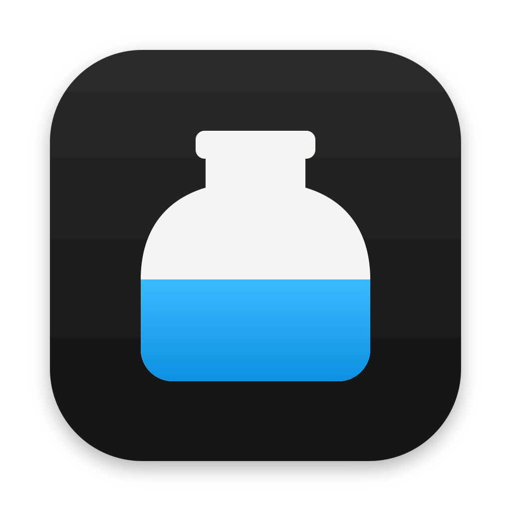
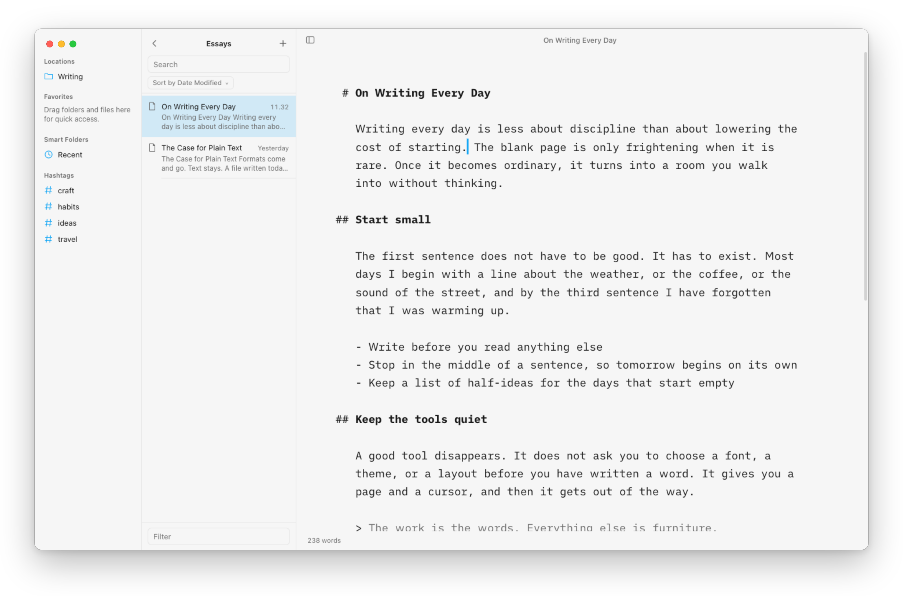
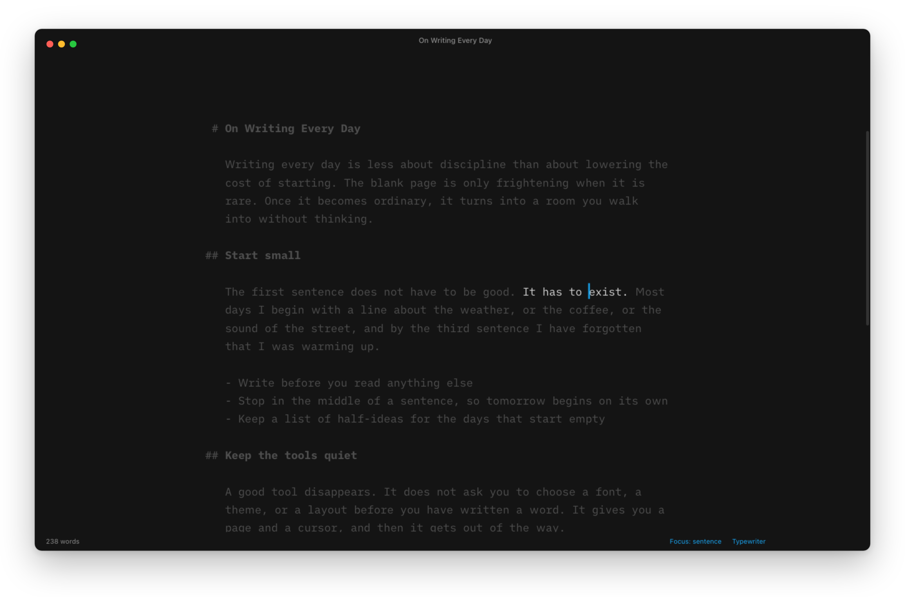
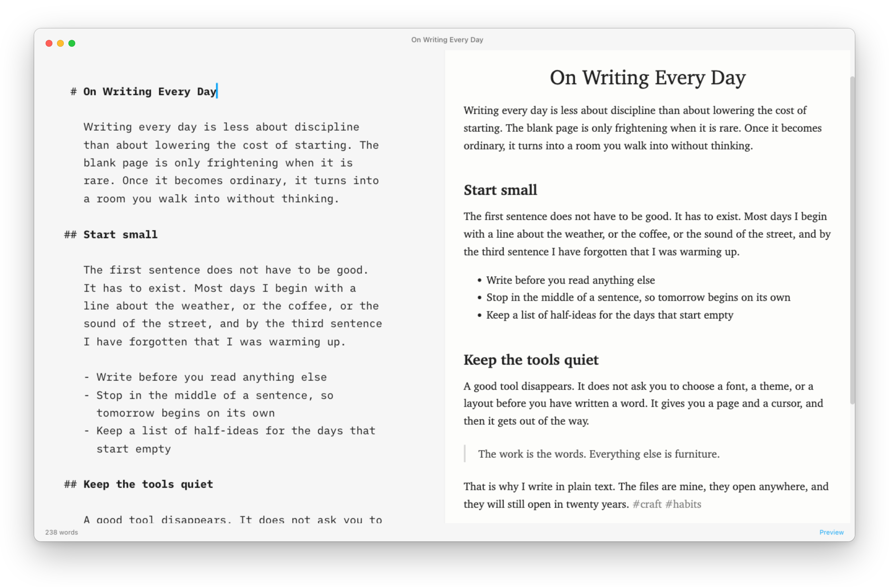
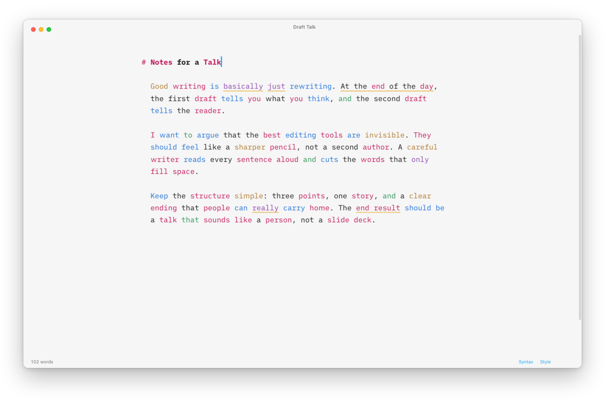
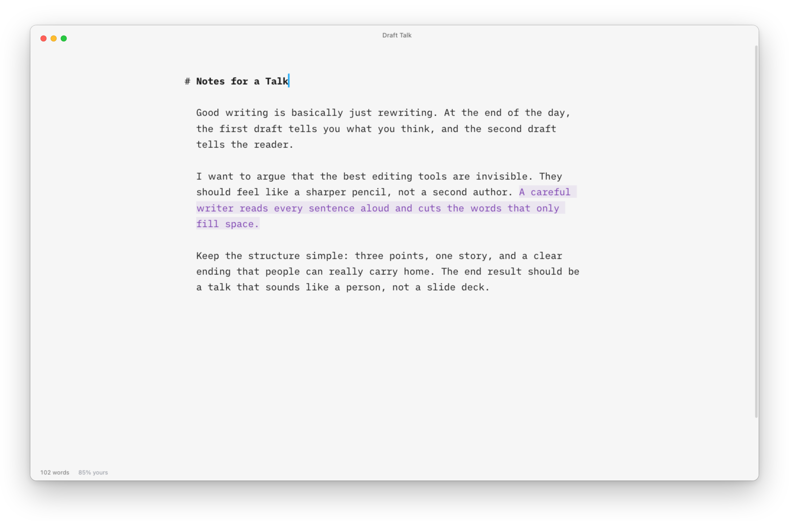

<p align="center">
  
</p>

<h1 align="center">Inkstand</h1>

<p align="center">A focused, open-source writing app for Markdown.<br>Plain text files in your own folders, typography first, and tools that help you write better without getting in the way.</p>

<p align="center">
  <a href="https://github.com/Magniswerfer/foss-write/releases/latest">Download</a> ·
  <a href="#features">Features</a> ·
  <a href="#development">Development</a>
</p>



| | |
| --- | --- |
|  |  |
| **Focus and typewriter modes** keep your eyes on the sentence you're writing. | **Live preview** with templates; export to PDF, Word, HTML and more. |
|  |  |
| **Syntax highlight and style check** show the shape of your sentences. | **Authorship** keeps track of what you wrote and what you didn't. |

Inkstand is free software under the GNU AGPL v3. It follows the ideas behind iA Writer and works with its templates, search syntax and URL commands, but it is an independent project with no affiliation to Information Architects.

## Features

**Writing**
- Distraction-free editor: Markdown shown in the text colour (or dimmed, or hidden), heading marks hanging in the margin, hanging indents for lists and quotes, a steady blue caret
- Ships with iA Writer Mono, Duo and Quattro (free under the SIL Open Font License, see `resources/app/fonts/iA-Writer-OFL.md`) plus IBM Plex Serif, or use any installed font
- Focus mode (sentence, paragraph or line) and typewriter mode that keeps your line centred, even straight after Return
- Syntax highlight for adjectives, nouns, adverbs, verbs and conjunctions
- Style check for fillers, clichés and redundancies, with replacements, an ignore list and custom word or regex patterns
- Smart quotes, dashes and ellipses; auto-paired brackets; list continuation; spell check
- Tables: add, delete and move rows and columns, align and sort columns, transpose; Tab between cells
- Transformations (Title Case, UPPER, lower, Capitalize); add date, hashtag, page break, table of contents, image link, display math; comments; callouts (`> [!NOTE]`, Tip, Important, Warning, Caution)
- Paste As plain text, Markdown, quote or code block; rich text pasted in becomes Markdown; Copy Markdown, HTML or rich text
- Read aloud (Start/Stop Speaking) in the document's language

**Authorship**
- Named authors (people, AI tools, references) with their own colours; pasted text is credited to the author you choose, typed text is yours
- Mark As, and Paste Edits From: apply an AI's revision as word-level edits, crediting only the words it changed
- Authorship is stored inside the document as a hidden comment with a checksum, so it travels with the file; edits made in other apps reset it instead of misattributing text
- A breakdown of who wrote how much in the status bar

**Library**
- Two columns, as in iA Writer: an organizer (locations, favourites, smart folders, hashtags) beside a file browser with a sort bar and a filter bar
- Search language compatible with iA Writer's: word prefixes, "phrases", #tags, `[ ]`/`[x]` tasks, `.ext`, `name:`, `^first`, AND / OR / NOT, NEAR, parentheses
- Smart folders from rules: ancestor or parent path, date created or modified, kind, extension, search
- Multi-select, Move To, New Folder with Selection, Copy Path, Get Info, drag to move or to favourite
- Quick open, command palette, go to heading, `[[wiki links]]` with completion, outline
- Version history with word-level diffs and restore; autosave; reloads when files change on disk

**Preview and output**
- Live preview, split or full, fit to width or as paper-sized pages
- Content blocks: a line like `/image.png "Caption"` embeds images, Markdown files, CSV tables and source code
- Math (KaTeX), footnotes, tables, task lists, definition lists, highlights, sub/superscript, `[TOC]`, front matter
- Export to PDF, HTML, Word (.docx), Markdown and plain text; Page Setup (paper, orientation, margins, header and footer); print; Print Plain Text
- Five built-in templates, plus iA Writer `.iatemplate` bundles
- Publish drafts to WordPress, Ghost, Medium and Micro.blog

**Settings and system**
- Single return starts a new paragraph; math on or off; tabs or spaces; wiki links by name or by path
- Reading and speaking time
- URL commands compatible with iA Writer's scheme (open, new, quick-search, read, write with add/patch and author credit, version, x-callback-url) under `inkstand://`
- Light, dark or system theme; translucent sidebar, Share menu and Dock menu on macOS; window chrome that fades while you type

## Install

Download the latest version for your system from [Releases](https://github.com/Magniswerfer/foss-write/releases/latest):

- **macOS:** `Inkstand-<version>-mac-arm64.dmg` for Apple Silicon, `…-mac-x64.dmg` for Intel. Open the disk image and drag Inkstand to Applications.
- **Windows:** `Inkstand-<version>-win-x64.exe` (or `-arm64`).
- **Linux:** the `.AppImage`, or the `.deb` for Debian and Ubuntu.

Until releases are signed with an Apple Developer ID, macOS asks before opening an app from an unidentified developer. The first time, right-click Inkstand in Applications and choose **Open**. Windows SmartScreen may likewise ask you to choose **More info → Run anyway**.

Upgrading from FOSS Write (Inkstand's working name)? Your settings, version history and authorship are carried over on first launch.

## Development

```bash
npm install
npm run dev
```

| Command | What it does |
| --- | --- |
| `npm run dev` | Run with hot reload |
| `npm run build` | Build into `out/` |
| `npm run typecheck` | TypeScript check |
| `npm test` | Unit tests (Vitest) |
| `npm run test:e2e` | Drive the built app with Playwright, off-screen (`FW_HEADLESS=1`), through every feature |
| `npm run dist` | Package installers for this platform into `dist/` |
| `npm run screenshots` | Retake the README screenshots |

### Releasing

1. Bump `version` in `package.json` and commit.
2. Tag and push: `git tag v0.1.0 && git push origin v0.1.0`.
3. The [Release workflow](.github/workflows/release.yml) builds macOS (Apple Silicon and Intel), Windows and Linux installers and attaches them to a **draft** release. Check it, write the notes, and publish.

macOS builds are ad-hoc signed by default. To sign and notarize them, add these repository secrets: `MAC_CERTIFICATE` (a base64-encoded Developer ID Application `.p12`), `MAC_CERTIFICATE_PASSWORD`, `APPLE_ID`, `APPLE_APP_SPECIFIC_PASSWORD` and `APPLE_TEAM_ID`. See `electron-builder.config.cjs`.

`npm run screenshots` retakes the images in `docs/screenshots` off-screen from the sample library in `scripts/sample-library`.

### Layout

- `src/main`: Electron main process (windows, menus, file system, templates, versions, PDF export, publishing)
- `src/preload`: the typed IPC bridge (`window.api`)
- `src/renderer`: the UI, made of the CodeMirror 6 editor (`editor/`), Markdown rendering and exporters (`markdown/`) and panels (`ui/`)
- `src/shared`: types and text helpers used on both sides
- `resources/templates`: built-in templates. Each template is a folder with `template.json`, `document.html` (an element marked `data-document` receives the content), and optional `header.html`, `footer.html` and `title.html` that use `data-title`, `data-author`, `data-date`, `data-page-number` and `data-page-count`.

## Credits

Inkstand ships iA Writer Mono, Duo and Quattro by Information Architects and IBM Plex Serif, both under the SIL Open Font License, plus KaTeX's fonts. The editor is built on CodeMirror, and Markdown rendering on markdown-it.

## Known limitations

- Syntax highlight and style check are English-only.
- The interface is English-only.
- Authorship data is stored on your computer, keyed by file path. It follows renames made inside the app, but not edits made in other apps.
